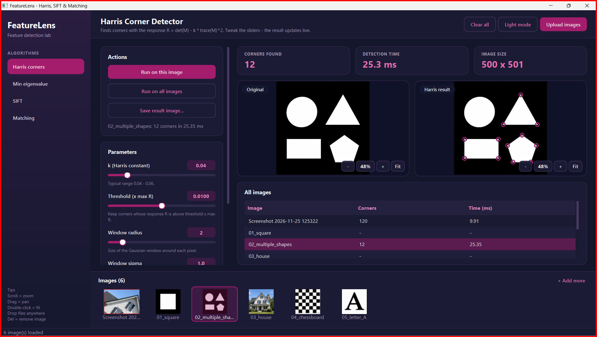
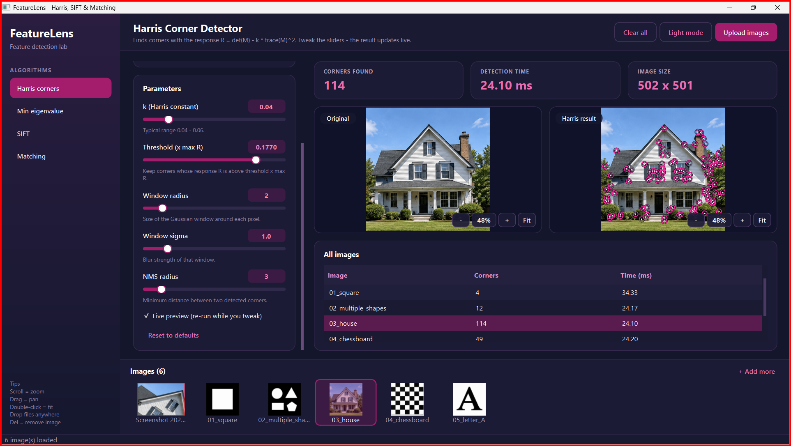
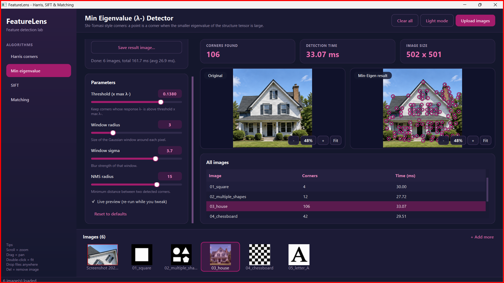
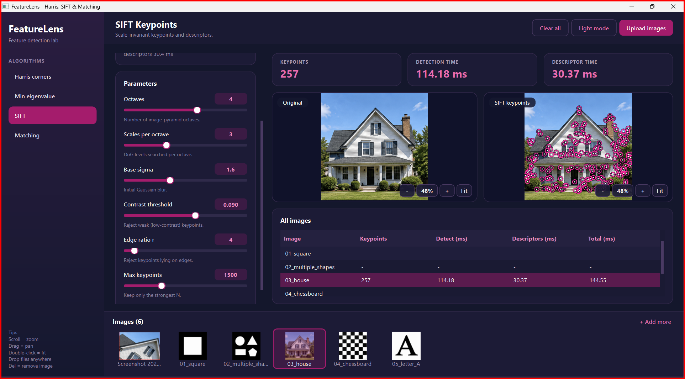
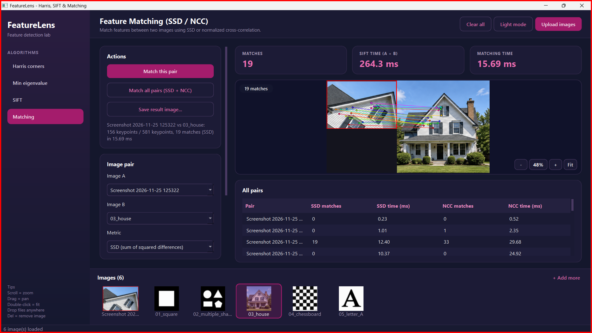

# FeatureLens

**Feature detection lab** – a desktop app (C++17 / Qt 6) that implements, from scratch and without OpenCV, the classic feature-detection pipeline:

- **Harris** corner detector
- **Min-eigenvalue (λ−)** / Shi-Tomasi corner detector
- **SIFT** keypoints + 128-D descriptors
- **Feature matching** between two images with **SSD** and **NCC**

Every algorithm has its own tab with live parameter sliders, timing statistics, a per-image results table, zoom/pan viewers and a "save result image" action. A headless batch tool is also included to generate every result image and the timing table for the assignment report.

---

## Screenshots

### Harris corner detector
Tweak `k`, threshold, window radius, sigma and NMS radius – the result updates live. On synthetic shapes Harris finds exactly the corners (rectangle, triangle, pentagon) and ignores the circle.



On a real photo the detector responds to window frames, roof edges and the chimney:



### Min-eigenvalue (λ−) detector
Shi-Tomasi style: a point is a corner when the **smaller** eigenvalue of the structure tensor is large.



### SIFT keypoints
Scale-space DoG keypoints with contrast and edge rejection; the table shows keypoints, detection time and descriptor time per image.



### Feature matching (SSD / NCC)
Pick Image A and Image B, choose the metric, and press **Match this pair** (or **Match all pairs** to fill the comparison table with SSD and NCC results and timings).



---

## Features

| Tab | What it does | Key parameters |
|---|---|---|
| **Harris corners** | Response `R = det(M) − k·trace(M)²` | `k`, threshold (× max R), window radius, window sigma, NMS radius |
| **Min eigenvalue** | Response = smaller eigenvalue λ− of `M` | threshold (× max λ−), window radius, window sigma, NMS radius |
| **SIFT** | DoG pyramid → keypoints → orientation → 128-D descriptor | octaves, scales/octave, base sigma, contrast threshold, edge ratio r, max keypoints |
| **Matching** | Descriptor matching between two images | metric (SSD / NCC), ratio / NCC threshold, mutual check |

Other GUI features:

- Dark / light theme (Ctrl+T, remembered between runs)
- Drag & drop images anywhere, **Upload images**, **Clear all**
- Scroll = zoom, drag = pan, double-click = fit
- `Del` removes the selected image
- Live preview while moving sliders, **Reset to defaults**
- **Run on this image** / **Run on all images** with a per-image table of corners and times
- **Save result image…** for any result

## How the algorithms work

**Harris** – Sobel gradients `Ix, Iy` → Gaussian-weighted structure tensor `M = [Sxx Sxy; Sxy Syy]` → `R = det(M) − k·trace(M)²` → threshold at `ratio × max R` → non-maximum suppression.

**Min eigenvalue** – same structure tensor, but the response is `λ− = (tr − √(tr² − 4·det)) / 2`; same threshold + NMS stage.

**SIFT** – Gaussian scale space with `octaves × scales` levels → Difference-of-Gaussians → 3-D extrema → low-contrast rejection → edge rejection with Lowe's ratio `r` → dominant orientation → 128-D L2-normalised descriptor. Detection time and descriptor time are reported separately.

**Matching**
- **SSD** – sum of squared differences between descriptors; a match is accepted when `best/second-best` passes Lowe's ratio test.
- **NCC** – normalised cross-correlation between descriptors; accepted when the best correlation ≥ threshold.
- Optional *mutual* check (the match must also be the best in the reverse direction).

## Project structure

```
FeatureLens/
├── CMakeLists.txt          # builds FeatureLens (GUI) + FeatureLensBatch (headless)
├── CMakePresets.json       # windows-msvc preset (Ninja + Qt 6)
├── build.bat / build.sh    # one-command build (optionally generates all results)
├── images/                 # sample input images
├── results/                # generated result images, timings.csv, report.md
├── docs/screenshots/       # screenshots used in this README
├── tools/
│   ├── batch.cpp           # headless runner (no Qt)
│   ├── run_all.py          # generates every result image + timing table
│   └── build_batch_only.sh
└── src/
    ├── main.cpp
    ├── common/             # Image, Draw, Types
    ├── features/           # HarrisDetector, MinEigenDetector, SiftDetector, Matcher
    └── gui/                # MainWindow, per-algorithm tabs, ImageView, theme, UI kit
```

## Build

### Requirements
- CMake ≥ 3.16
- A C++17 compiler (MSVC 2022 on Windows, or GCC/Clang)
- Qt 6 (Widgets) – only for the GUI; the batch tool has no dependencies
- Python 3 + Pillow (`pip install pillow`) – only for `tools/run_all.py`

### Windows (MSVC + Ninja)
Edit `CMAKE_PREFIX_PATH` in `CMakePresets.json` (default `C:/Qt/6.12.0/msvc2022_64`) if Qt is installed elsewhere, then from a *x64 Native Tools* prompt:

```bat
cmake --preset windows-msvc
cmake --build out/build --config Release
out\build\FeatureLens.exe
```

`windeployqt` is run automatically after the build so the Qt DLLs are copied next to the executable.

### Linux / macOS
```bash
./build.sh                       # set QT_PREFIX=/path/to/Qt/6.x/gcc_64 if CMake can't find Qt
```

## Generating the result images

`FeatureLensBatch` runs each algorithm headless and `tools/run_all.py` drives it over every image in `images/`:

```bash
python tools/run_all.py --exe path/to/FeatureLensBatch
# or: build.bat results   /   ./build.sh results
```

Output goes to `results/`:

| Path | Content |
|---|---|
| `results/harris/`, `results/mineig/`, `results/sift/` | result images, colour and grayscale versions |
| `results/matching/` | SSD / NCC matches against a rotated + scaled + brightened copy, and all image pairs (`pairs/`) |
| `results/timings.csv`, `results/report.md` | computation time of every case |

## Sample timings

From `results/report.md` (detection only, single thread):

| Image | Harris | Min-eig | SIFT detect | SIFT keypoints |
|---|---|---|---|---|
| 01_square | 19.3 ms | 18.1 ms | 98.3 ms | 10 |
| 02_multiple_shapes | 10.9 ms | 11.1 ms | 56.0 ms | 45 |
| 03_house | 12.7 ms | 12.3 ms | 60.6 ms | 581 |
| 04_chessboard | 12.5 ms | 10.9 ms | 58.4 ms | 486 |
| 05_letter_A | 13.3 ms | 11.4 ms | 57.3 ms | 54 |

Harris and min-eigenvalue cost about the same (both are dominated by the Gaussian-windowed tensor); SIFT is several times slower because of the scale-space pyramid and descriptors. NCC matching is roughly 2–3× slower than SSD for the same descriptor sets.

## License

Educational project – add the license of your choice here.
